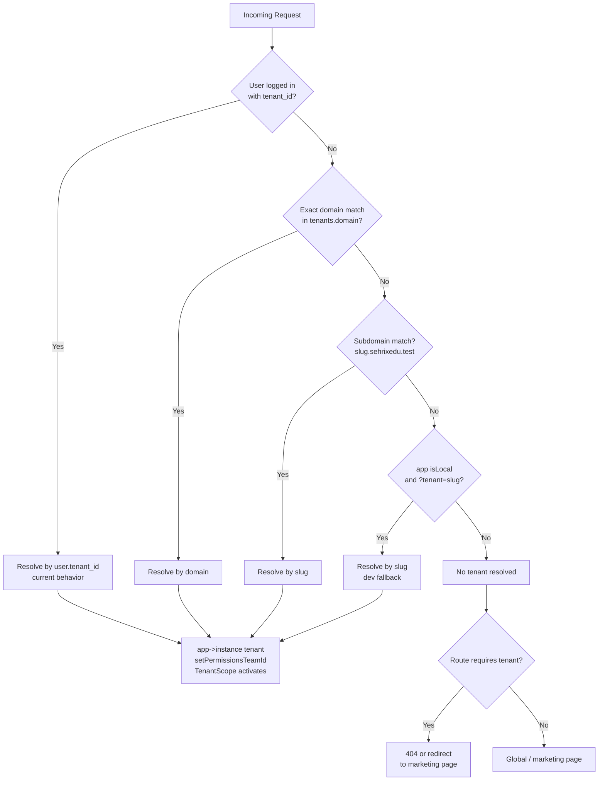

# Multi-Tenant Site Resolution & Per-Tenant Branding — Master Plan

> **Project:** SehrixEdu · **Stack:** Laravel 11 + Inertia + React/TSX + MySQL + ShadCN/Tailwind
> **Architecture:** Single DB + `tenant_id` scoping (Option A) — keep as-is ✅

---

## Current State Snapshot

```mermaid
flowchart LR
    subgraph Already Done ✅
        A[ResolveTenant middleware\nexact domain + subdomain\n+ ?tenant=slug fallback]
        B[BelongsToTenant trait\n+ TenantScope global scope]
        C[tenants.slug UNIQUE\ntenants.domain nullable]
        D[Admin TenantController\ndomain + slug editing]
        E[Impersonation\nbinds tenant via user]
    end

    subgraph Missing ❌
        F[tenant prop NOT\nshared to Inertia]
        G[app.blade.php title\nhardcoded to app.name]
        H[No logo_path\nprimary_color\ntagline columns]
        I[Settings controller\nonly updates name+address]
        J[SESSION_DOMAIN\nnot configured]
        K[?tenant=slug runs\nin ALL environments]
    end
```

---

## Open Decisions (Resolved)

| Decision | Choice |
|---|---|
| Domain strategy | ✅ Both: subdomain (`school1.sehrixedu.test`) + custom domain (`school1.com`) optional |
| No tenant resolved? | ✅ Show global marketing/landing page (`welcome.tsx`) |
| Path fallback for local dev | ✅ Keep `?tenant=slug` — but gate it behind `app()->isLocal()` |
| Architecture | ✅ Single DB + `tenant_id` scoping — no DB-per-tenant |

---

## Architecture: How Tenant Resolution Works



---

## Implementation Phases

---

### ✅ Phase 1 — Inertia Tenant Prop + Branding *(zero DB changes)*

> [!IMPORTANT]
> This is the **highest ROI phase** — 3 file edits, no migrations, instant payoff.

#### 1A · `HandleInertiaRequests.php`

**File:** `app/Http/Middleware/HandleInertiaRequests.php`

```php
public function share(Request $request): array
{
    $tenant = app()->bound('tenant') ? app('tenant') : null;

    return [
        ...parent::share($request),

        // Tenant name takes priority over global app name
        'name' => $tenant?->institute_name ?? config('app.name'),

        // Full tenant branding object (null for super-admin / marketing)
        'tenant' => $tenant ? [
            'id'             => $tenant->id,
            'institute_name' => $tenant->institute_name,
            'slug'           => $tenant->slug,
            'domain'         => $tenant->domain,
            'logo_path'      => $tenant->logo_path ?? null,
            'primary_color'  => $tenant->primary_color ?? null,
            'tagline'        => $tenant->tagline ?? null,
        ] : null,

        'auth' => [
            'user'             => $request->user(),
            'roles'            => $request->user() ? $request->user()->getRoleNames() : [],
            'permissions'      => $request->user() ? $request->user()->getAllPermissions()->pluck('name') : [],
            'is_impersonating' => $request->session()->has('impersonate.original_user_id'),
        ],
        'sidebarOpen' => !$request->hasCookie('sidebar_state') || $request->cookie('sidebar_state') === 'true',
        'flash' => [
            'type'    => $request->session()->get('type') ?? ($request->session()->has('success') ? 'success' : ($request->session()->has('error') ? 'error' : null)),
            'message' => $request->session()->get('message') ?? $request->session()->get('success') ?? $request->session()->get('error'),
        ],
    ];
}
```

---

#### 1B · `app.blade.php` — Dynamic title + OG tags

**File:** `resources/views/app.blade.php`

```blade
@php
    $siteName = app()->bound('tenant')
        ? app('tenant')->institute_name
        : config('app.name');
    $tagline = app()->bound('tenant') && app('tenant')->tagline
        ? app('tenant')->tagline
        : 'One Platform. Every School.';
@endphp

{{-- Replace both static occurrences: --}}
<meta name="description" content="{{ $tagline }}">
<meta property="og:title" content="{{ $siteName }}">
<meta property="og:description" content="{{ $tagline }}">

{{-- In <x-inertia::head>: --}}
<title>{{ $siteName }}</title>

{{-- Optional: inject primary_color CSS variable --}}
@if(app()->bound('tenant') && app('tenant')->primary_color)
<style>
    :root { --brand-primary: {{ app('tenant')->primary_color }}; }
    html.dark { --brand-primary: {{ app('tenant')->primary_color }}; }
</style>
@endif
```

---

#### 1C · `app-logo.tsx` — Tenant logo fallback

**File:** `resources/js/components/app-logo.tsx`

```tsx
import { usePage } from '@inertiajs/react';
import AppLogoIcon from '@/components/app-logo-icon';

export default function AppLogo() {
    const { tenant } = usePage<any>().props;

    if (tenant?.logo_path) {
        return (
            
        );
    }

    // Fall back to the global Sehrix SVG logo
    return <AppLogoIcon className="h-11 w-auto" />;
}
```

---

#### 1D · `app-sidebar.tsx` — Show school name under logo

**File:** `resources/js/components/app-sidebar.tsx`

In the `<SidebarHeader>` block, after `<AppLogo />`:

```tsx
const { tenant } = usePage<any>().props;

// Inside <Link href={dashboard()} prefetch>:
<AppLogo />
{tenant && (
    <span className="ml-2 hidden truncate text-sm font-semibold leading-tight group-data-[state=expanded]:block">
        {tenant.institute_name}
    </span>
)}
```

---

#### 1E · `login.tsx` — Tenant-aware auth branding

**File:** `resources/js/pages/auth/login.tsx`

```tsx
import { usePage } from '@inertiajs/react';

export default function Login({ status, canResetPassword, canRegister }: Props) {
    const { tenant } = usePage<any>().props;
    // ...existing JSX unchanged...
}

// Make layout dynamic based on resolved tenant:
Login.layout = (page: React.ReactElement) => {
    const tenant = page.props.tenant;
    return {
        title: tenant
            ? `Log in to ${tenant.institute_name}`
            : 'Log in to your account',
        description: tenant?.tagline
            ?? 'Enter your email and password below to log in',
    };
};
```

---

#### 1F · Security fix — Gate `?tenant=slug` to local env

**File:** `app/Http/Middleware/ResolveTenant.php`

```php
// Dev fallback: ?tenant=slug (local only)
if (app()->isLocal() && $request->has('tenant')) {
    return Tenant::where('slug', $request->query('tenant'))->first();
}
```

---

### 🏗️ Phase 2 — Branding columns migration

#### 2A · New migration

```php
// database/migrations/2026_10_31_000002_add_branding_to_tenants_table.php

Schema::table('tenants', function (Blueprint $table) {
    // Add unique index on domain (it's nullable but needs to be unique when set)
    $table->string('domain')->nullable()->unique()->change();

    $table->string('logo_path', 500)->nullable()->after('domain');
    $table->string('primary_color', 7)->nullable()->after('logo_path');  // e.g. #3B82F6
    $table->string('tagline', 200)->nullable()->after('primary_color');
});
```

> [!WARNING]
> Run `composer require doctrine/dbal` before `->change()` on MySQL if not already installed.

Run: `php artisan migrate`

---

#### 2B · `Tenant` model — add fillable branding fields

**File:** `app/Models/Tenant.php`

```php
// Add to the model (or remove $guarded = [] and use $fillable):
protected $fillable = [
    'institute_name', 'slug', 'owner_name', 'domain',
    'status', 'plan', 'settings',
    'logo_path', 'primary_color', 'tagline',  // ← new
];
```

---

#### 2C · `Settings\TenantController.php` — extend update()

**File:** `app/Http/Controllers/Settings/TenantController.php`

```php
use Illuminate\Support\Facades\Storage;

public function update(Request $request): RedirectResponse
{
    if (!Auth::user()->tenant_id) {
        abort(403, 'Only school administrators can update this page.');
    }

    $tenant = Tenant::findOrFail(Auth::user()->tenant_id);

    $validated = $request->validate([
        'name'          => 'required|string|max:100',
        'address'       => 'nullable|string|max:200',
        'tagline'       => 'nullable|string|max:200',
        'primary_color' => ['nullable', 'string', 'regex:/^#[0-9A-Fa-f]{6}$/'],
        'logo'          => 'nullable|image|mimes:png,jpg,svg|max:512',
        'domain'        => [
            'nullable', 'string', 'max:253',
            Rule::unique('tenants', 'domain')->ignore($tenant->id),
        ],
    ]);

    // Handle logo upload
    if ($request->hasFile('logo')) {
        // Delete old logo
        if ($tenant->logo_path) {
            Storage::disk('public')->delete(str_replace('/storage/', '', $tenant->logo_path));
        }
        $path = $request->file('logo')->store("tenants/{$tenant->slug}/logo", 'public');
        $tenant->logo_path = Storage::url($path);
    }

    $tenant->update([
        'institute_name' => $validated['name'],
        'address'        => $validated['address'] ?? null,
        'tagline'        => $validated['tagline'] ?? null,
        'primary_color'  => $validated['primary_color'] ?? null,
        'domain'         => $validated['domain'] ?? null,
    ]);

    Inertia::flash('toast', ['type' => 'success', 'message' => __('School settings updated.')]);

    return to_route('tenant.edit')->with('status', 'school-updated');
}
```

> [!TIP]
> Use `router.post('/settings/Institute', { ...data, logo: file, _method: 'PATCH' }, { forceFormData: true })` on the frontend when uploading files — `patch()` doesn't support multipart.

---

#### 2D · `settings/tenant.tsx` — Add branding fields

**File:** `resources/js/pages/settings/tenant.tsx`

```tsx
interface TenantData {
    id: number;
    institute_name: string;
    address: string | null;
    tagline: string | null;
    primary_color: string | null;
    logo_path: string | null;
    domain: string | null;
    slug: string;
}

// Extend useForm:
const { data, setData, post, processing, errors, recentlySuccessful } = useForm({
    name: tenant.institute_name || '',
    address: tenant.address || '',
    tagline: tenant.tagline || '',
    primary_color: tenant.primary_color || '#3B82F6',
    domain: tenant.domain || '',
    logo: null as File | null,
    _method: 'PATCH',  // method spoofing for file upload
});

const handleSubmit = (e: React.FormEvent) => {
    e.preventDefault();
    post('/settings/Institute', { forceFormData: true, preserveScroll: true });
};

// New form fields to add:
{/* Tagline */}
<div className="grid gap-2">
    <Label htmlFor="tagline">Tagline</Label>
    <Input id="tagline" value={data.tagline}
        onChange={e => setData('tagline', e.target.value)}
        placeholder="e.g. Excellence in Education" />
    <InputError message={errors.tagline} />
</div>

{/* Brand color */}
<div className="grid gap-2">
    <Label htmlFor="primary_color">Brand Color</Label>
    <div className="flex items-center gap-3">
        <input type="color" id="primary_color"
            value={data.primary_color}
            onChange={e => setData('primary_color', e.target.value)}
            className="h-10 w-16 cursor-pointer rounded border p-1" />
        <span className="text-sm text-muted-foreground font-mono">{data.primary_color}</span>
    </div>
    <InputError message={errors.primary_color} />
</div>

{/* Logo upload */}
<div className="grid gap-2">
    <Label htmlFor="logo">Logo (PNG / SVG, max 512 KB)</Label>
    {tenant.logo_path && (
        
    )}
    <Input type="file" id="logo" accept="image/png,image/jpeg,image/svg+xml"
        onChange={e => setData('logo', e.target.files?.[0] ?? null)} />
    <InputError message={errors.logo} />
</div>

{/* Custom domain */}
<div className="grid gap-2">
    <Label htmlFor="domain">Custom Domain <span className="text-muted-foreground text-xs">(optional)</span></Label>
    <Input id="domain" value={data.domain}
        onChange={e => setData('domain', e.target.value)}
        placeholder="portal.myschool.com" />
    <p className="text-xs text-muted-foreground">
        Point your domain's A record to this server, then save. Your subdomain
        <code className="mx-1 rounded bg-muted px-1">{tenant.slug}.sehrixedu.com</code>
        always works regardless.
    </p>
    <InputError message={errors.domain} />
</div>
```

---

### 🌐 Phase 3 — DNS / vhost / session config

#### 3A · `.env` settings

```dotenv
APP_URL=http://sehrixedu.test
SESSION_DOMAIN=.sehrixedu.test      # leading dot = all subdomains share session cookie
```

#### 3B · EnvKit wildcard site (local dev)

1. Open EnvKit → Sites → Create site
2. Host: `*.sehrixedu.test` (wildcard)
3. Root: `F:\EnvKit\projects\sehrixedu\public`
4. PHP version: match your project

Test with: `http://school1.sehrixedu.test` (needs a tenant with `slug = school1`)

#### 3C · Production nginx (wildcard vhost)

```nginx
server {
    listen 80;
    server_name ~^(?<slug>.+)\.sehrixedu\.com$ sehrixedu.com;

    root /var/www/sehrixedu/public;
    index index.php;

    location / {
        try_files $uri $uri/ /index.php?$query_string;
    }

    location ~ \.php$ {
        fastcgi_pass unix:/run/php/php8.3-fpm.sock;
        include fastcgi_params;
        fastcgi_param SCRIPT_FILENAME $realpath_root$fastcgi_script_name;
    }
}
```

> [!NOTE]
> For custom domains (`school.com`), add a separate `server_name school.com;` block or use a dynamic vhost. Laravel resolves the tenant from `tenants.domain` automatically — no extra nginx work needed beyond routing the domain to the same app.

---

### 🛡️ Phase 4 — Optional branding: CSS variables

**File:** `resources/views/app.blade.php`

If `primary_color` is set, apply it globally. Works with ShadCN's `--primary` token:

```blade
@if(app()->bound('tenant') && app('tenant')->primary_color)
<style>
    :root {
        --primary: {{ app('tenant')->primary_color }};
        --ring: {{ app('tenant')->primary_color }};
    }
</style>
@endif
```

> [!TIP]
> ShadCN uses `oklch()` under the hood in Tailwind v4. If your buttons don't update, you may need to convert the hex to oklch. Use a PHP helper or a tiny JS snippet that sets `document.documentElement.style.setProperty('--primary', tenant.primary_color)` inside a `useEffect`.

---

### 👑 Phase 5 — Super-Admin panel improvements

**File:** `resources/js/pages/admin/tenant/Index.tsx`

Add a "Visit" column that shows the resolved domain or subdomain:

```tsx
const getSchoolUrl = (tenant: Tenant) => {
    if (tenant.domain) return `https://${tenant.domain}`;
    return `http://${tenant.slug}.sehrixedu.test`;  // swap .test for .com in production
};

// In table row:
<a href={getSchoolUrl(tenant)} target="_blank" rel="noopener noreferrer"
   className="inline-flex items-center gap-1 text-xs text-blue-600 hover:underline">
    {tenant.domain ?? `${tenant.slug}.sehrixedu.test`}
    <ExternalLink className="h-3 w-3" />
</a>
```

---

## Complete File Change Summary

```mermaid
flowchart LR
    subgraph Phase1["Phase 1 — No DB changes"]
        P1A["HandleInertiaRequests.php\nadd tenant prop + dynamic name"]
        P1B["app.blade.php\ndynamic title + OG + CSS var"]
        P1C["app-logo.tsx\ntenant logo fallback"]
        P1D["app-sidebar.tsx\nschool name under logo"]
        P1E["login.tsx\ntenant-aware layout"]
        P1F["ResolveTenant.php\ngate ?tenant to isLocal"]
    end

    subgraph Phase2["Phase 2 — 1 migration"]
        P2A["Migration:\nlogo_path primary_color tagline\n+ domain UNIQUE index"]
        P2B["Tenant.php model\nfillable branding fields"]
        P2C["Settings/TenantController.php\nlogo upload + color + domain"]
        P2D["settings/tenant.tsx\nnew branding form fields"]
    end

    subgraph Phase3["Phase 3 — Config"]
        P3A[".env\nSESSION_DOMAIN"]
        P3B["EnvKit wildcard site\n*.sehrixedu.test"]
    end

    subgraph Phase4["Phase 4 — Polish"]
        P4A["CSS --primary variable\nper tenant color"]
        P4B["Admin tenant/Index.tsx\ndomain quick-visit link"]
    end

    Phase1 --> Phase2 --> Phase3 --> Phase4
```



---

## Security & Safety Checklist

| Risk | Fix | Status |
|---|---|---|
| `?tenant=slug` spoofable in prod | Gate with `app()->isLocal()` | 📋 Phase 1F |
| Custom domain squatting | DNS TXT ownership check before saving domain | 📋 Future |
| Logo path traversal | Use `store()` not `move()`, validate MIME strictly | ✅ In Phase 2C |
| Unscoped super-admin queries | `withoutGlobalScope(TenantScope::class)` already used | ✅ Done |
| Session cookie leaking across tenants | `SESSION_DOMAIN=.sehrixedu.test` | 📋 Phase 3A |
| `primary_color` XSS in blade | Validated with strict hex regex `/^#[0-9A-Fa-f]{6}$/` | ✅ In Phase 2C |

---

## Out of Scope (deferred)

- Database-per-tenant isolation
- Schema-per-tenant (requires Postgres)
- Email notifications for tenant activation
- DNS TXT ownership verification
- Stripe/billing per plan enforcement

---

## Quick-start for local testing right now

```bash
# 1. Test without ANY DNS changes using ?tenant=slug:
http://sehrixedu.test/login?tenant=your-school-slug

# 2. After Phase 1 is done, the page title will show the school name.
# 3. After Phase 2 migration:
php artisan migrate
php artisan storage:link   # so logo URLs resolve under /storage/

# 4. For wildcard subdomain testing, configure EnvKit wildcard + .env SESSION_DOMAIN
```
